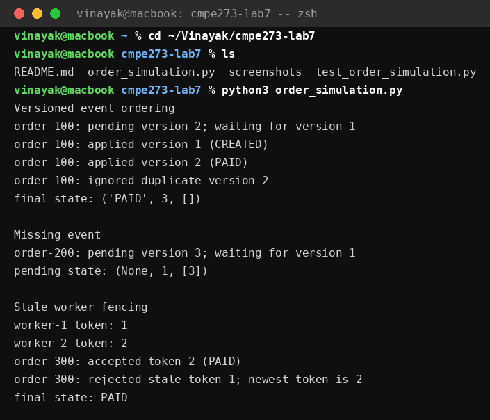
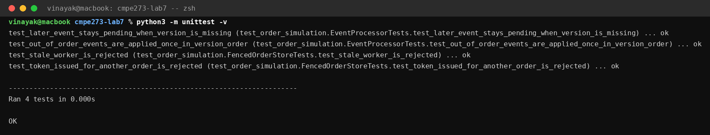

# Module 7: Time, Ordering & Coordination

This project simulates an order-processing service that receives delayed, out-of-order, and duplicate updates. It also demonstrates fencing tokens preventing an older worker from overwriting a newer worker's update.

## Requirements

- Python 3.9 or newer

## Run the simulation

```bash
python3 order_simulation.py
```

Run the automated checks with:

```bash
python3 -m unittest -v
```

## Implementation

Each `OrderEvent` contains an `order_id`, `version`, and `status`. `EventProcessor` applies only the next expected version, stores later versions as pending, drains pending versions after a gap is filled, and ignores versions that have already been applied.

`FencedOrderStore` gives each worker an increasing token. Only the newest token issued for an order can update it. An older token is rejected as stale, and a token issued for a different order is rejected too, so a delayed worker cannot overwrite a newer update.

## Evidence

Running the demo shows all three cases in one pass:



The first section demonstrates delivery in the order version 2, version 1, and version 2 again. Version 2 waits as pending until version 1 arrives, then both versions are applied in order, and the second version 2 is ignored as a duplicate. The missing-event section sends only version 3, so it is recorded as pending while waiting for version 1, and the order keeps no status instead of jumping ahead to SHIPPED. The fencing section shows worker 2's newer token accepted and worker 1's older token rejected, so the final status comes from the newer worker.

A duplicate later version is also ignored while it is still pending, so repeated deliveries cannot replace or apply an event twice.

The automated checks cover the same cases, plus a token issued for a different order being rejected:



## Reflection

Timestamps alone do not guarantee event ordering because separate machines can have different clocks and network delay can make an older event arrive after a newer one. Two events can also receive the same timestamp or have clock adjustments that change their apparent order. A version assigned by the order's update sequence gives the consumer a logical order that does not depend on wall-clock accuracy. The consumer still needs a policy for gaps, duplicates, and delayed messages, which is why this simulation tracks the next expected version and pending events.
